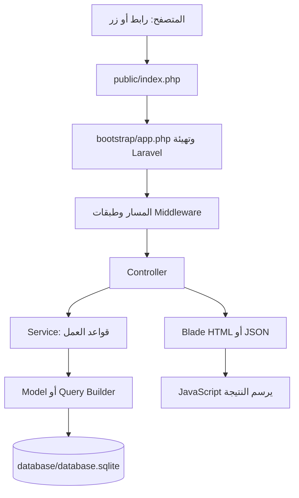
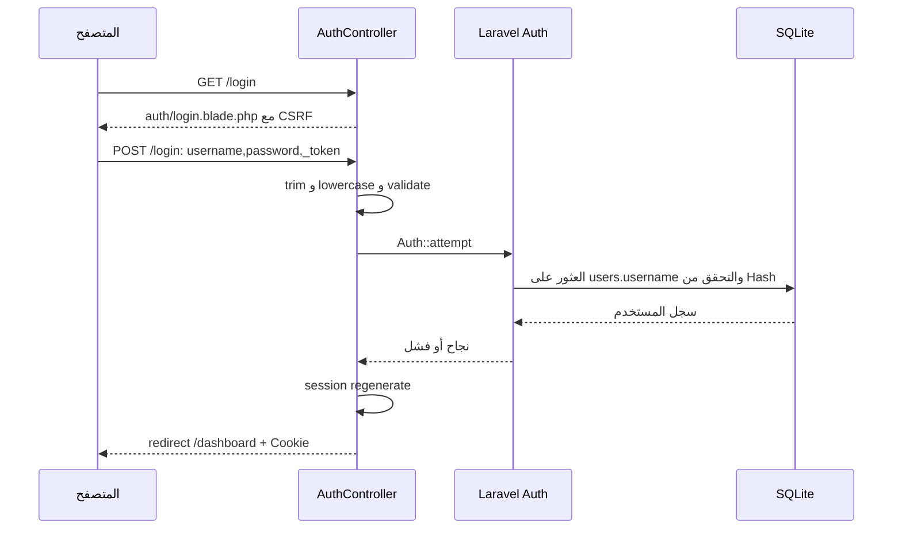

# 01 — الهيكل ومسار الطلب وتسجيل الدخول

## 1. المشروع ثلاثة أجزاء تتعاون

**واجهة** تظهر في المتصفح، **معالجة** تنفذ على PHP، و**قاعدة بيانات** تحفظ الحالة. الواجهة ترسل طلبًا HTTP، ولا تتصل بملف قاعدة البيانات مباشرة. PHP هو الذي يقرر هل العملية مسموحة، ويتحقق من قيمها، وينفذها، ثم يعيد صفحة HTML أو بيانات JSON.

في amrbit، صفحات الإدارة تشترك في قالب Blade واحد. بعد فتح القالب تطلب JavaScript بيانات القسم وتحوّلها إلى بطاقات وجداول. هذه نقطة مهمة: كلمة «صفحة» في المتصفح لا تعني بالضرورة ملف PHP مستقلًا يحمل الاسم نفسه.



هذا مخطط مبسط؛ تهيئة Providers تحصل ضمن بدء Laravel، والـ Middleware يحيط بتنفيذ المسار والاستجابة. بعض الطلبات للقراءة تنتهي في Controller دون Service، بينما الحفظ المالي يمر بخدمات ومعاملة قاعدة بيانات.

## 2. ماذا يوجد في كل مجلد؟

| المجلد/الملف | وظيفته في نسختنا | متى تعدله؟ |
|---|---|---|
| app/Http/Controllers | استقبال الطلب، فحص المدخلات والصلاحية، استدعاء الخدمات، إعادة الرد | إجراء أو بيانات صفحة |
| app/Http/Middleware | فحص يمر على مجموعات طلبات، مثل الشركة ورؤوس الأمان | قاعدة مشتركة لكل طلب |
| app/Models | تمثيل الجداول وعلاقاتها وتحويل أنواع الحقول | عمود أو علاقة أو طريقة قراءة |
| app/Services | قواعد البيع والمخزون والرحلات والعملاء | تغيير سلوك العمل |
| app/Providers | ربط خدمات التطبيق وتهيئة Gates ومحدد الدخول | تهيئة عامة |
| app/Policies | قواعد صلاحية مرتبطة بموديل؛ هنا VisitPolicy | تفويض قراءة/تنفيذ مورد |
| app/Enums | قيم محصورة للأدوار وحالات الزيارة | إضافة حالة/دور مع مراجعة استعمالاته |
| app/Support | CompanyContext الذي يحمل الشركة والدور خلال الطلب | عزل الشركات |
| routes/web.php | روابط المتصفح وصفحات النظام وطلبات ops | رابط أو إجراء متصفح |
| routes/api.php | نقاط دخول الأجهزة بالرمز؛ يضاف إليها /api تلقائيًا | تكامل تطبيق جهاز |
| routes/console.php | أمر inspire الافتراضي؛ ليس فيه الآن جدولة رحلات تلقائية | أوامر الطرفية |
| resources/views | قوالب Blade الأربعة | هيكل الصفحة/الدخول/الطباعة/أيقونة |
| public/js | الواجهة التي ترسم الأقسام وتتعامل مع الأزرار | جدول أو نموذج أو تفاعل |
| public/css | تنسيق الواجهة؛ light.css آخر ملف في القالب المشترك | اللون/الترتيب/المقاس |
| public/vendor/leaflet | مكتبة الخرائط المحلية | تحديث مدروس للمكتبة، لا قواعد الأعمال |
| public/index.php | مدخل طلبات PHP على الويب | غالبًا لا تحتاج تغييره |
| database/migrations | تاريخ إنشاء الجداول وتطوير أعمدتها وقيودها | تعديل دائم لبنية قاعدة البيانات |
| database/seeders | بيانات العرض التجريبية | مثال بيانات في نسخة منفصلة |
| database/factories | بيانات للاختبارات؛ UserFactory | تجهيز اختبار |
| database/database.sqlite | البيانات الفعلية لهذه النسخة | تفتحه بأداة SQLite، لا محرر نصوص |
| config | إعداد Laravel والخدمات | سياسة جلسة، اتصال قاعدة، لغة… |
| bootstrap/app.php | ربط ملفات المسارات والـ Middleware ونقطة health | تهيئة التطبيق |
| bootstrap/providers.php | قائمة Providers الخاصة بالتطبيق | تسجيل Provider جديد |
| bootstrap/cache | ملفات تهيئة يولدها Laravel | لا تعدلها يدويًا |
| storage/logs | سجلات الأخطاء بحسب قناة logging | تبحث فيها عند الخطأ |
| storage/framework | Blade مترجم وكاش وملفات تشغيل | مخرجات مؤقتة؛ عدل المصدر بدلًا منها |
| tests/Feature | سيناريوهات الدخول والبيع والعزل والزيارات… | إثبات أن التغيير يعمل ويحافظ على القواعد |
| tests/Unit | مثال اختبار صغير افتراضي حاليًا | دوال مستقلة لاحقًا |
| scripts | تشغيل PHP المستقل والخادم والنسخ والشبكة | تشغيل محلي موثق |
| docs | وثائق المتطلبات والتنفيذ وهذا الدليل | تحديث الشرح مع أي تغيير |
| lang/ar | رسائل validation وترجمة fieldflow | نصوص أخطاء Laravel؛ أغلب نصوص الواجهة مكتوبة في JS |
| vendor | مكتبات Composer ومنها Laravel | لا تعدلها لإصلاح تطبيقك |
| node_modules | أدوات Node، وأبرزها Prettier | تُدار بالحزم، وليست مصدر الأقسام |
| .env | إعدادات هذه النسخة وأسرارها | إعدادات محلية؛ لا تشارك APP_KEY |
| .env.example | مثال إعداد، ليس الإعداد الفعلي | إرشادات تجهيز نسخة جديدة |
| composer.json / composer.lock | متطلبات PHP والإصدارات المثبتة والتحميل التلقائي | تحديث تبعيات مدروس |
| package.json / package-lock.json | أوامر فحص وتنسيق JS وحزم Node | أدوات واجهة التطوير |
| artisan | مدخل أوامر Laravel من الطرفية | تستخدمه، ولا تعدل محتواه عادة |
| phpunit.xml | إعداد الاختبارات وقاعدة :memory: المعزولة | بيئة فحص |
| .runtime | بيانات تشغيل وتجربة ونسخ محلية مساعدة | ليست مصدر التطبيق ولا مجلد نشر عام |

الجذر الذي يخدمه خادم الويب يجب أن يكون `public`؛ بقية الملفات لا ينبغي تقديمها للمتصفح كملفات عامة.

## 3. Controller و Service و Model بمثال بسيط

**Controller** مثل موظف استقبال الطلب: يأخذ Request، يحدد الإجراء، يرفض من لا يملك الصلاحية، ويسلم العمل للجهة المناسبة. **Service** يعرف خطوات العملية: هل يجوز تغيير الموقع؟ هل هناك زيارة جارية؟ ما الذي يُسجل في التاريخ؟ **Model** يعرف كيف يمثل سجل العميل وعلاقته بالمنطقة والمندوب.

في تعديل الهاتف:

```php
// تصور مقتطف من التدفق الحالي؛ ليس ملفًا إضافيًا مطلوبًا.
$model = app(CustomerMaintenance::class)->contact($request);
return ['id' => $model->id, 'message' => 'تم الحفظ بنجاح.'];
```

`app(...)` يطلب كائن الخدمة من حاوية Laravel. إذا احتاجت خدمة إلى خدمات في constructor يستطيع Laravel تجهيزها. في `TradingWorkflow` مثلًا يمرر `StockLedger` و`AuditRecorder` تلقائيًا. `use App\Services\...` يحدد الاسم الكامل للكلاس؛ لا ينفذ عملية بيع أو استعلامًا بمجرد كتابته. Composer يجعل `App\` يشير إلى مجلد `app`، فلا نكتب require لكل Controller.

## 4. تفاصيل فتح /customers

1. المتصفح يرسل `GET /customers` ومعه Cookie الجلسة إن سبق الدخول.
2. `public/index.php` يحمل `vendor/autoload.php` ثم `bootstrap/app.php` ويطلب معالجة Request.
3. Laravel يهيئ خدماته و`AppServiceProvider`. المسار يأتي من `routes/web.php`.
4. مجموعة web الافتراضية تدير Cookies والجلسة وحماية CSRF لطلبات التغيير. `auth` يمنع الضيف. `company` يثبت العضوية الفعالة والشركة.
5. `OperationsController::page` يراجع أن دورك يستطيع فتح customers، ثم يعيد `view('app', ...)`.
6. Laravel يقرأ `resources/views/app.blade.php` ويحول تعابير Blade إلى HTML. يضع section و role في بيانات body، واسم الشركة والقوائم حسب الدور.
7. المتصفح يحمل CSS و JS. `app.js` ينفذ `load(true)` ثم يطلب `GET /ops/data`.
8. `OperationsController::data` يجمع بيانات الشركة، ويقيد حساب المندوب بعملائه، ثم يعيد JSON.
9. `render()` يختار `customersPage()`، والتي تستخدم `AmrbitJourney.customers()` في customer-journey.js. يظهر الجدول.
10. الضغط على عميل يفتح `/customers/ID`؛ يتأكد CustomerJourneyController من الوصول، ثم تستخدم الواجهة `/ops/customers/ID` لجلب الملف المفصل.

الانتقال بين روابط الأقسام في الغالب انتقال متصفح لصفحة جديدة، وليس Router في React. داخل الصفحة توجد تبويبات وحوارات يعاد رسمها دون تحميل الصفحة كلها. الجلب الدوري كل 15 ثانية يجري عندما تكون النافذة ظاهرة ولا يوجد حوار مفتوح، وتستثنى صفحة التقارير من ذلك التحديث العام. هذا **polling** وليس WebSocket.

## 5. ما معنى Provider في هذا المشروع؟

`app/Providers/AppServiceProvider.php` كلاس تهيئة. ليس صفحة ولا جدولًا. Laravel يستدعي:

- `register()`: يسجل `CompanyContext` بعمر scoped؛ أي نسخة مشتركة ضمن دورة الطلب/المهمة، بدل كائن عام يمتد بين كل المستخدمين.
- `boot()`: يعرف Gate باسم manage-operations للمدير والمشرف، و view-directory للأدوار التشغيلية، ومحدد محاولات login.

المحدد يسمح بخمس محاولات في الدقيقة لمفتاح اسم مستخدم موحد مع عنوان IP، وبعشرين محاولة للدقيقة لعنوان IP إجمالًا. تعريفه في Provider وتطبيقه على مساري POST login وإصدار token يجعلان السلوك واحدًا في نقطتي الدخول.

أما `providers` داخل **config/auth.php** فمعناه مختلف: مصدر العثور على المستخدم في المصادقة. المصدر هنا Eloquent وموديل User. و`guards.web` يختار session كآلية المصادقة. لا يوجد في نسختنا AuthServiceProvider مستقل خاص بالمشروع؛ هذا ليس نقص ملف مطلوب لإنجاح الدخول في Laravel الحديث.

## 6. Authentication خطوة بخطوة



`AuthController::create()` يعرض النموذج. `store()` يوحد اسم المستخدم بحذف الفراغات الطرفية وتحويله لحروف صغيرة، ثم يفحص طول الاسم وكلمة المرور. `Auth::attempt` يستخدم config/auth.php للعثور على User ومقارنة كلمة المرور المدخلة بالـ Hash. الكود لا يسترجع كلمة مرور واضحة ولا يفك تشفيرها.

عند الفشل تظهر رسالة عامة «اسم المستخدم أو كلمة المرور غير صحيحة». عند النجاح يتغير معرف الجلسة لمنع تثبيت جلسة سابقة، ثم يوجه إلى dashboard. الجلسات مخزنة في جدول `sessions` لأن SESSION_DRIVER=database. المتصفح يحمل Cookie الجلسة، وليس جدول المستخدمين أو كلمة المرور.

المشروع يستخدم اسم مستخدم، لا البريد. عمود email باقٍ للتوافق مع بنية Laravel، ولا يعني أن شاشة الدخول تطلبه. User يخفي password و remember_token من التحويل إلى JSON؛ و cast باسم hashed يحول كلمات المرور عند إسنادها عبر Eloquent إلى Hash.

**تسجيل الخروج**: `Auth::logout()` ثم invalidate للجلسة ثم regenerateToken لـ CSRF، ثم إعادة إلى login. إعادة تعيين كلمة المرور بالبريد وتأكيد البريد و 2FA ليست واجهات منفذة هنا لمجرد وجود إعداد أو جدول لها.

## 7. الدخول لا يساوي الصلاحية

`auth` يسأل: من أنت؟ `SetCompanyContext` يسأل: بأي شركة تعمل الآن، وما دورك فيها؟ كود الإجراء يسأل: هل لهذا الدور تنفيذ هذه العملية، وهل السجل يخصه؟

`SetCompanyContext::handle` يبدأ بمسح أي سياق قديم، يجلب الشركات الفعالة ذات عضوية فعالة، ويختار company_id من الجلسة أو أول شركة. إذا كان الاختيار المحفوظ غير صالح لا ينتقل بصمت إلى شركة أخرى؛ يرفض. يحول role إلى CompanyRole، ثم يشارك activeCompany و companyRole و availableCompanies مع Blade. وفي finally يمسح السياق بعد انتهاء الطلب.

`CompanyController::switch` لا يغير company_id في كل السجلات؛ يغير الشركة المختارة في الجلسة بعد التأكد من العضوية، ويجدد الجلسة ثم يعيد الرئيسية.

أغلب Models ترث TenantModel. عند الاستعلام يضيف شرط company_id تلقائيًا. إذا غاب السياق يعيد شرطًا لا يُظهر سجلات (`1 = 0`). وعند الإنشاء يضيف company_id، وعند التحديث يمنع تغييره. هذا سبب شائع لظهور «لا توجد بيانات» في Tinker إن نسيت تحديد CompanyContext.

**Query Builder لا يرث هذا الحاجز**: `DB::table(...)` يحتاج شرط الشركة صراحة. لذلك ترى الشرط مكتوبًا في معالجة company_user ومناطق المندوب والتقارير. ولا تكفي معرفة رقم العميل أو إخفاء زر في الواجهة لمنح الصلاحية؛ الخادم يعيد فحصها.

## 8. الأدوار الفعلية

| الدور | المعنى العملي |
|---|---|
| manager | إدارة الشركة والفريق والحسابات والحد الائتماني، مع العمليات والمال |
| supervisor | إدارة العمليات والعملاء والخطط والأسطول ومشاهدة المال، دون إنشاء بيع أو استلام تحصيل أو اعتماد نقد وفق المصفوفة الحالية |
| representative | عملاؤه ورحلاته وفواتيره؛ البيع والتحصيل مشروطان بـ can_sell/can_collect والتغطية |
| accountant | العملاء والطلبات والتحصيل وعهدة النقد والتقارير المالية؛ ليس إدارة التتبع أو تخطيط الرحلات |
| viewer | قراءة تشغيلية دون تفاصيل المبيعات والتحصيل |

هذه ليست RBAC ديناميكية بكل صلاحية في جدول permission منفصل. القواعد الحالية موزعة بين CompanyRole، قوائم page، allowed لكل action، Services، وبعض Gates و VisitPolicy. عند إضافة صلاحية جديدة راجعها كلها؛ لا تعدل القائمة المرئية وحدها. جدول الإجراءات في الفصل 02 أدق من أسماء الأدوار المجردة.

## 9. حماية التغيير والتكرار

- `@csrf` يضيف الحقل المخفي للنماذج العادية. قالب التطبيق يضع CSRF في meta، و execute في JS يرسله في X-CSRF-TOKEN لطلبات JSON.
- `request_id` UUID يميز العملية الواحدة؛ OperationOnce يحفظ نتيجتها في operation_receipts داخل transaction. نفس الطلب ونفس المدخلات يعيدان النتيجة دون خصم أو تحصيل ثانٍ، بينما تغيير المحتوى مع نفس المعرف يرفض بـ 409.
- الصلاحية تفحص قبل إعادة نتيجة العملية القديمة، حتى لا يعيد العضو عملية بعد سحب دوره.
- `profile_version` و`plan_version` و`operations_version` تكشف التعديل المتزامن. تكرار الإرسال مختلف عن فتح نسختين قديمتين وتعديلهما؛ لذلك نحتاج المعرف والنسخة معًا.
- AuditRecorder يكتب الفاعل والإجراء ونوع السجل ومعرفه و metadata والوقت. في المصدر الحالي لا يحفظ عنوان IP تلقائيًا في audit_logs.

## 10. دخول تطبيق جهاز عبر API

`POST /api/v1/token` يأخذ username و password و device_name. DeviceAuthController يستخدم Hash::check، يفحص وجود عضوية فعالة، يمنع أكثر من عشرة رموز محفوظة بعد تنظيف المنتهية، وينشئ رمزًا لصلاحيات operations:read و operations:write ينتهي خلال سبعة أيام. الرمز الواضح يُعاد عند الإصدار، وقاعدة Sanctum تحفظ تمثيله المجزأ.

الطلبات التالية تحمل:

```http
Authorization: Bearer YOUR_DEVICE_TOKEN
X-Company-ID: 1
Accept: application/json
```

`auth:sanctum` يتحقق من الرمز، و SetApiCompanyContext يتحقق من الشركة والعضوية وقدرة read أو write، ثم تُطبق صلاحيات الإجراء نفسها. DELETE token يلغي الرمز الحالي فقط. مسارات العملاء/الجدول الحديثة تحت ops/journey لم تُعرض كلها في API الأجهزة؛ وجود API لا يعني أن تطبيق Android أو التتبع الخلفي المستمر قد بُني.

## 11. كيف تقرأ نتيجة الخطأ؟

| الكود | معناه المحتمل هنا |
|---|---|
| 401 | لم يعد المستخدم مسجلًا في طلب JSON |
| 403 | دور أو عضوية أو ملكية أو Token ability لا تسمح |
| 404 | السجل غير موجود ضمن شركة السياق أو الرابط غير معرف |
| 409 | نسخة بيانات تغيرت أو request_id مستخدم بمحتوى مختلف |
| 419 | جلسة/CSRF انتهى أو غير مطابق |
| 422 | المدخلات أو شرط العمل لا يسمحان بالتنفيذ |
| 429 | محاولات أكثر من الحد المسموح |
| 500 | خطأ برمجي/تشغيل؛ راجع logs مع تفاصيل الطلب |

`execute()` في JS يحول أخطاء validation إلى رسالة في النموذج. بعض طلبات الجلب تعرض رسالة عامة؛ نافذة Network تساعدك رؤية الرد الحقيقي. الفصل 06 يشرح ذلك عمليًا.

المفاهيم العامة متوافقة مع [دورة الطلب الرسمية](https://laravel.com/docs/13.x/lifecycle)، [Providers](https://laravel.com/docs/13.x/providers)، [Auth](https://laravel.com/docs/13.x/authentication)، [Sanctum](https://laravel.com/docs/13.x/sanctum). أما ترتيب خدمات amrbit وشروطه أعلاه فمن قراءة مصدره الحالي.
