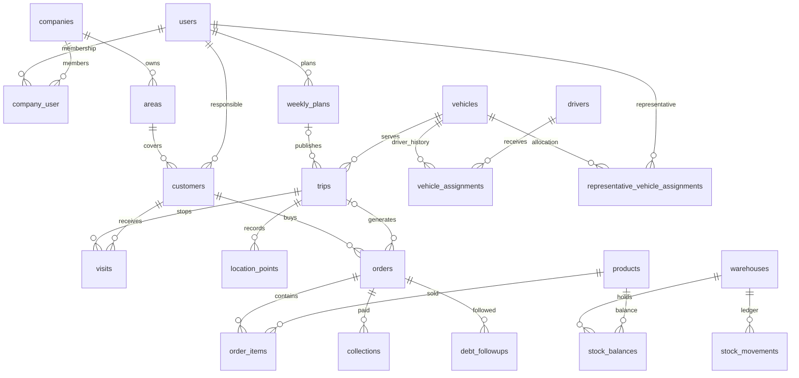

# 05 — قاعدة البيانات وفتحها وفهم علاقاتها

## 1. أين قاعدة البيانات فعلًا؟

```text
C:\xampp\htdocs\fieldflow-next\database\database.sqlite
```

هذا الملف هو القاعدة المستخدمة افتراضيًا في النسخة الحالية. فُحصت إعدادات `.env` و config/database.php وملف القاعدة الموجود: DB_CONNECTION=sqlite، و DB_DATABASE غير مضبوط بقيمة أخرى، فيستخدم Laravel database_path('database.sqlite'). فحص البنية تم باستخدام SQLite3 بوضع READONLY دون تشغيل migrations أو seeders أوتغيير أي سجل.

سبب عدم رؤيتها في phpMyAdmin: هو أداة لإدارة MySQL/MariaDB، بينما SQLite محرك يقرأ ملفًا مباشرًا من PHP. لا تحتاج تشغيل MySQL في XAMPP ليعمل اتصال SQLite هذا. [تعريف phpMyAdmin الرسمي](https://docs.phpmyadmin.net/en/latest/intro.html)، [مشغل SQLite في PHP](https://www.php.net/manual/en/ref.pdo-sqlite.php).

لا تغيّر DB_CONNECTION إلى mysql لتظهر البيانات؛ ذلك يختار محركًا آخر ولا ينقل الجداول والسجلات. الانتقال مستقبلًا يحتاج إنشاء قاعدة وتجهيز بنيتها، ونقل البيانات مع المعرفات والروابط، وفحص المجاميع والمعاملات، ثم تبديل الاتصال. SQLite مناسبة للتطوير المحلي الحالي؛ اختيار قاعدة نشر متعددة المستخدمين يحتاج فحص التزامن والحجم والنسخ والاستعادة.

## 2. كيف تفتحها بواجهة شبيهة بفكرة phpMyAdmin؟

استخدم **DB Browser for SQLite** من [التنزيل الرسمي](https://sqlitebrowser.org/dl/). توجد نسخة ZIP لـ Windows إذا أردت تشغيلًا دون مثبت. لم يُثبَّت برنامج جديد ضمن إعداد هذا الدليل.

1. افتح البرنامج.
2. اختر **Open Database**، لا New Database.
3. اختر المسار أعلاه. للتعلم ابدأ بفتح للقراءة فقط أو نسخة احتياطية من القاعدة.
4. **Database Structure** يعرض الجداول والأعمدة والفهارس.
5. **Browse Data** ثم اختر users لمشاهدة الحسابات، أو customers للعملاء، أو company_user للأدوار.
6. **Execute SQL** يسمح باستعلام SELECT، مثل الأمثلة أدناه.
7. في حالة فتح قابل للكتابة، التعديلات قد تبقى معلقة حتى **Write Changes**؛ و**Revert Changes** يلغي التعديلات غير المكتوبة. أغلق أي transaction تحرير قبل العودة لتجربة النظام، كي لا تحجز القاعدة.

لا يوجد مستخدم root أو كلمة مرور لمحرك SQLite هذا. صلاحية قراءة الملف على Windows هي الوصول إلى القاعدة المحلية. `amr` و`sara` حسابات التطبيق التجريبية؛ ليست بيانات اتصال القاعدة. ووجود Hash لكلمة المرور لا يعني أن ملف القاعدة كله مشفر؛ من يقرأ الملف يستطيع رؤية بقية البيانات.

لا ترفع ملف القاعدة إلى موقع فحص SQLite عبر الإنترنت؛ افتحه محليًا. قبل التحرير المباشر خذ نسخة متسقة بالطريقة الموثقة في الفصل 06، واستخدم واجهات النظام لتغيير العمليات المالية والمخزون لأنها تطبق أكثر من تحديث عمود واحد.

## 3. كيف تصل من داخل Laravel دون برنامج إضافي؟

هذه أوامر تعلم تنفذها أنت من PowerShell في مجلد النسخة الحالية:

```powershell
Set-Location -LiteralPath 'C:\xampp\htdocs\fieldflow-next'
.\scripts\php.ps1 artisan tinker
```

Tinker يفتح جلسة PHP محمّلة بـ Laravel. الأوامر التالية **قراءة**:

```php
config('database.default');
DB::connection()->getDatabaseName();
App\Models\User::select('id', 'name', 'username')->get();
App\Models\Company::select('id', 'name', 'timezone', 'currency')->get();
```

User و Company ليسا TenantModel، فتظهر قراءتهما دون سياق شركة. أما العملاء والطلبات فيحتاجان تعيين سياق صريح:

```php
$company = App\Models\Company::findOrFail(1);
$context = app(App\Support\CompanyContext::class);
$context->set($company, App\Enums\CompanyRole::Manager);
App\Models\Customer::select('id', 'name', 'phone', 'representative_id')->get();
$context->clear();
```

هذا للتعلم داخل طرفية مطور موثوقة، وليس API يعطي أي حساب صلاحية المدير. Tinker لا يمر تلقائيًا بكل Middleware والصلاحيات. `Customer::count()` قبل تحديد السياق قد يعيد صفرًا لأن TenantModel يحجب البيانات دون سياق، وليس لأن القاعدة فارغة.

## 4. تعديل الحساب واسم المستخدم وكلمة المرور

الأفضل لحسابات الأعضاء العادية: سجل دخول مدير ← الفريق ← الحساب والصلاحيات. هذا يحفظ قواعد الشركة والمناطق والأثر، ويحمي هوية الحساب المشترك. حساب المدير نفسه محمي من تعديل الفريق؛ لذلك إن احتجت تعديل المدير بصفة مطور تستخدم Tinker بعد فهم الأثر.

مثال تعليمي **يكتب** عند تنفيذه؛ لم يُنفذ على بياناتك الآن:

```php
$u = App\Models\User::where('username', 'sara')->firstOrFail();
$u->name = 'سارة المحاسبة';
$u->save();
```

مثال تغيير اسم الدخول: تأكد أن الاسم غير مستخدم، واستخدم حروفًا صغيرة متوافقة مع صيغة التطبيق: `a-z` وأرقام و`.` و`_` و`-`، ثم احفظه:

```php
App\Models\User::where('username', 'sara.accounting')->exists();
$u->username = 'sara.accounting';
$u->save();
```

مثال تغيير كلمة المرور عبر Model:

```php
$u->password = 'Use-A-New-Long-Test-Password';
$u->save();
```

User::casts يحتوي `password => hashed`؛ لذلك يحول Eloquent القيمة إلى Hash عند إسنادها. **لا تكتب كلمة المرور الواضحة في عمود password من DB Browser**، ولا تستخدم Query Builder لحفظها كنص؛ فهو يتجاوز casts. `Hash::check($entered, $storedHash)` يفحص التطابق، ولا يسترجع النص الأصلي.

تحرير Tinker المباشر لا ينفذ MemberAdministration ولا يسجل AuditRecorder تلقائيًا، ولا يلغي كل الجلسات والرموز السابقة بمجرد تغيير السر. وللحساب المشترك بين شركتين يتغير اسمه وكلمة مروره لهما معًا. لذلك تعديل الصلاحيات والتغطية من الشاشة هو المسار المعتاد؛ أدوات المطور للتشخيص والإصلاح المقصود بعد نسخة احتياطية.

## 5. مجموعات الجداول

| المجموعة | الجداول | المعنى |
|---|---|---|
| الهوية والشركات | users, companies, company_user, representative_areas | من يدخل، لأي شركة، وبأي دور وتغطية وقدرات |
| العملاء | areas, customers, customer_changes | المنطقة والملف والمسؤول والنقطة وطلبات اعتمادها |
| الأسطول | vehicles, drivers, vehicle_assignments, representative_vehicle_assignments | المورد، السائق، الاستلام الفعلي، وتخصيص عمل المندوب |
| الميدان | weekly_plans, trips, visits, location_points | قالب أسبوعي، تنفيذ مؤرخ، محطة، نقطة GPS |
| المخزون | products, warehouses, stock_balances, stock_movements | الصنف والموقع والرصيد والدفتر |
| البيع والمال | orders, order_items, collections, debt_followups, cash_handovers | طلب وأسطره واستلام عميل ومتابعة دين وتسليم نقد |
| رقابة التنفيذ | audit_logs, operation_receipts | من عمل ماذا، ومنع تكرار عملية واحدة |
| بنية Laravel | migrations, sessions, cache, cache_locks, jobs, job_batches, failed_jobs, password_reset_tokens, personal_access_tokens | تهيئة وجلسات وكاش وطوابير ورموز؛ وجود الجدول لا يعني تنفيذ كل واجهة مرتبطة به |

عدد الجداول 35 يشمل جداول البنية. الفصل 07 يسرد كل عمود ونوعه وقيمته الافتراضية وعلاقاته وفهارسه، دون عرض كلمات المرور أو محتويات الجلسات والرموز.

## 6. العلاقات الأساسية



المخطط مبسط للقراءة؛ لا يعرض كل company_id أو كل قيود المفاتيح المركبة. ربط مندوب بعميل ينبغي أن يكون بعضوية في **نفس الشركة**، وليس users.id فقط. تعريف القيود الدقيق في الفصل 07.

### User ليس هو الدور أو السائق

`users` يحفظ اسمًا واسم دخول وسرًا لهوية الشخص. `company_user` يحفظ دوره داخل الشركة مع phone و employee_code و area_access و can_sell و can_collect و notes. الحساب الواحد قد يملك عضويتين، ولهذا وجدنا 15 حسابًا و 16 عضوية وقت الفحص. `drivers` سجلات سائقين منفصلة؛ إنشاء سائق لا ينشئ حساب دخول تلقائيًا.

### تخصيص المركبة للمندوب يختلف عن استلام السائق

`representative_vehicle_assignments` يحدد مركبة العمل المخصصة للمندوب وتاريخها. `vehicle_assignments` يسجل تسليم المركبة لسائق برخصته وإرجاعه. `trips.vehicle_id/driver_id` يحفظان موارد الرحلة. تغيير واحدة من هذه العلاقات لا يعني نقل البضاعة أو إعادة كتابة التاريخ في الأخرى.

### الأرقام النشطة والنسخ

حقول active_vehicle_id و active_representative_id و active_driver_id مفاتيح مساعدة لقيود التفرد في الحالة النشطة. عند الإغلاق أو الإرجاع تُفرغ إلى null، بينما تبقى المعرفات الأصلية لتاريخ السجل. لا تغيّر الحقول المساعدة منفردة لجعل المركبة «متاحة».

profile_version للعميل، و plan_version للرحلة، و version للقالب الأسبوعي، و operations_version لبيانات المندوب: تكشف حفظ نسخة قديمة فوق نسخة أحدث. هي ليست معرف المستخدم ولا معرف العملية.

## 7. مبالغ المال والمخزون

`*_minor` مبلغ بالوحدة الصغيرة. في SAR، القيمة 12345 تعني 123.45 ريال. تخزين أعداد صحيحة يقلل أخطاء الكسور العائمة. الواجهة تقسم على 100 للعرض، والخادم يحسب سعر الطلب من products ويحفظ سعر السطر وقت إنشائه في order_items؛ تغيير سعر المنتج لاحقًا لا يمحو سعر السطر القديم.

```text
إجمالي طلب = SUM(order_items.quantity × unit_price_minor)
دين فاتورة مسلمة = orders.total_minor − orders.paid_minor
دين عميل = SUM(المتبقي على طلباته fulfilled)
نقد محمول = SUM(collections نقدية للمستلم) − SUM(cash_handovers المعتمدة عليه)
نقد متاح لطلب تسليم جديد = نقد محمول − SUM(طلبات تسليم معلقة)
رصيد مخزون = SUM(stock_movements.quantity) بحسب الشركة/العهدة/الصنف
```

stock_balances يحفظ الرصيد السريع للقراءة، و stock_movements الدفتر الذي يفسره: الزيادة موجبة والخصم سالب. التحويل حركتان بمرجع واحد. لا تعدل الرصيد أو المدفوع يدويًا لتحسين رقم على الشاشة؛ إصلاح العملية يجب أن يحفظ تطابق الدفتر ومجاميع الإيصالات.

`credit_limit_minor=null` يعني عدم تحديد حد في الكود الحالي؛ والصفر يمنع دينًا جديدًا. تخفيض الحد لا ينهي دينًا سابقًا. `cash` و`bank` و`card` وسائل استلام؛ تسجيل إيصال bank ليس ربطًا مصرفيًا أو إثبات تحويل من خدمة خارجية.

## 8. SQL مفيد للقراءة في DB Browser

استبدل company_id حسب الشركة التي تراجعها؛ الاستعلام المباشر لا يطبق TenantModel.

```sql
-- الحسابات دون إظهار Hash كلمة المرور
SELECT id, username, name FROM users ORDER BY id;

-- الشركة والدور وحالة العضوية
SELECT u.id, u.username, u.name, c.name AS company_name,
       cu.role, cu.is_active, cu.can_sell, cu.can_collect
FROM company_user cu
JOIN users u ON u.id = cu.user_id
JOIN companies c ON c.id = cu.company_id
ORDER BY c.id, u.id;

-- العملاء ومسؤول كل عميل
SELECT c.id, c.name, c.phone, a.name AS area, u.name AS representative
FROM customers c
LEFT JOIN areas a ON a.id = c.area_id AND a.company_id = c.company_id
LEFT JOIN users u ON u.id = c.representative_id
WHERE c.company_id = 1
ORDER BY c.name;

-- الآجل الحالي بالريال، وليس قيمة المسودات
SELECT c.id, c.name,
       ROUND(SUM(o.total_minor - o.paid_minor) / 100.0, 2) AS debt
FROM orders o
JOIN customers c ON c.id = o.customer_id AND c.company_id = o.company_id
WHERE o.company_id = 1 AND o.status = 'fulfilled'
GROUP BY c.id, c.name
HAVING SUM(o.total_minor - o.paid_minor) > 0;

-- رصيد المخزون مقابل دفتره؛ فرق غير صفري يحتاج مراجعة
SELECT b.warehouse_id, b.product_id, b.quantity AS balance,
       COALESCE(SUM(m.quantity), 0) AS ledger,
       b.quantity - COALESCE(SUM(m.quantity), 0) AS difference
FROM stock_balances b
LEFT JOIN stock_movements m ON m.company_id = b.company_id
 AND m.warehouse_id = b.warehouse_id AND m.product_id = b.product_id
WHERE b.company_id = 1
GROUP BY b.id, b.warehouse_id, b.product_id, b.quantity;

-- محطات رحلة محددة (استبدل 1 بمعرف الرحلة المقصود)
SELECT id, customer_id, sequence, status, location_verified, outcome_note
FROM visits WHERE company_id = 1 AND trip_id = 1 ORDER BY sequence, id;
```

## 9. Migrations و Seeders و Factories

Migration وصف لتغيير بنية القاعدة، وليس البيانات الحالية نفسها. الدالة up تطبق الإضافة أو التعديل، و down تصف العكس عند rollback. Laravel يسجل ما طُبق في migrations. تعديل ملف قديم طُبق على قاعدتك لن يعيد تشغيله تلقائيًا؛ أضف Migration جديدًا.

| الملف/المرحلة | ما أضافته |
|---|---|
| 0001 users/cache/jobs | حسابات وجلسات وإعادة كلمة مرور وكاش وطوابير |
| 2026_10_12_000100 | نواة الشركات وعضوياتها والمناطق والعملاء والمركبات والزيارات والأثر |
| 2026_10_12_000200 | مخزون وطلبات وتحصيل ورحلات وتتبع واستلام عمليات |
| 2026_10_13_000300 | شروط نقدي/جزئي/آجل واستحقاق وحد ائتمان |
| 2026_10_13_000400 و 000500 | متابعة دين وتسليم عهدة نقد |
| 2026_10_13_071027 | جدول Sanctum tokens |
| 2026_10_18_000001 | حقول موارد وأدوار وقدرات ومناطق وسائقين وإسناد فعلي |
| 2026_10_20_000001 | نسخ خطة الرحلة والإلغاء وتاريخهما |
| 2026_10_22_000001 | username للدخول وإبقاء email اختياريًا |
| 2026_10_24_000001 | مسؤول العميل وقالب الأسبوع وربط النشر وأسباب الزيارة؛ استنتاج مالك قديم فقط عند وضوحه |
| 2026_10_24_000002 | profile_version |
| 2026_10_24_000003 | customer_changes و representative_vehicle_assignments ونسخة بيانات المندوب |

`DatabaseSeeder::run` يستدعي OperationsDemoSeeder ثم CreditDemoSeeder. الأول يجهز شركتين وبيانات عرض وحسابات، ويشترط local/testing و FIELDFLOW_DEMO. يستخدم firstOrCreate للحسابات حتى لا يعيد ضبط كلمة مرور حساب قديم غيّرها صاحبه. الثاني يكمل شروط آجل طلبات العرض القديمة. DemoSeeder أقدم وليس ضمن السلسلة الحالية. UserFactory::definition ينشئ بيانات اختبار، و unverified يعطي حالة بريد غير موثق؛ لا يعني ذلك وجود تحقق بريد مفروض الآن.

وجود Seeders لا يعني تشغيلها عند كل فتح للموقع. `migrate:fresh` يمسح الجداول، و rollback قد يحذف أعمدة وبيانات؛ لا تستخدمهما لفهم البنية. الدليل وسجل migrations يكفيان للقراءة.
