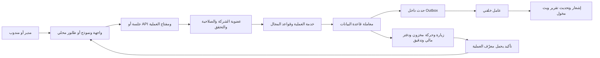
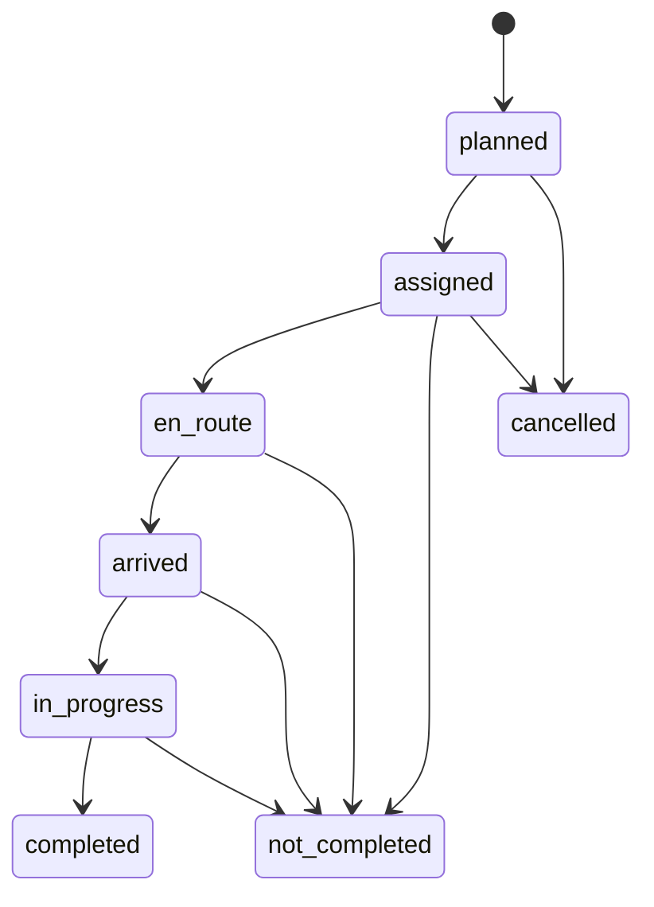

# FieldFlow Next: تصميم النظام وخطة الوصول إلى منتج متين

**نسخة وثيقة:** 1.0 — **تاريخ:** 12 أكتوبر 2026.

## 1. معنى المتطلبات وحالتها

هذه الوثيقة تصف **المنتج المستهدف**؛ لا تصف حالة تنفيذ الكود في المشروع الجديد. مصدر كل نوع من القرارات:

- **مطلوب صراحة من المستخدم:** مشروع جديد مستقل، أقوى من المرجع في التتبع والتقارير والأقسام والواجهة وتسهيل عمل المدير والمندوب، توزيع عام متعدد الشركات، بيانات تجريبية، شرح تعليمي، وعدم تعطيل المشاريع السابقة.
- **مستنتج من المرجع:** جدولة عملاء متكررة، بدء رحلة، حمولة، تسليم وتحصيل ونتيجة زيارة. يجب تحسينها دون التقيد بحقول مياه فقط.
- **قرار تصميم مقترح:** تفاصيل الجداول، مدد الاحتفاظ، حدود الدقة، مؤشرات الأداء، مكونات التقنية والمراحل الواردة أدناه. قيمها افتراضات قابلة للمراجعة، وليست التزامات إنتاج أو نتائج اختبارات.
- **غير محسوم قبل الاستخدام الحقيقي:** قواعد الضرائب والفوترة والائتمان والدول، عدد الأجهزة، موافقات التتبع، الاستضافة والعقود ومزود الرسائل والخرائط.

المصدر الفني لهذه المقترحات موثق في [بحث المصادر](RESEARCH_AR.md)، بتاريخ التحقق نفسه.

## 2. تجربة المنتج

### المدير ومشرف التشغيل

يدخل المدير إلى «ماذا يحتاج قراري اليوم؟»: زيارات متأخرة، مندوب انقطعت بياناته، سيارة تحتاج صيانة، طلب ينتظر مخزونًا، فرق نقد/عهدة، واعتماد خارج نطاق الموقع. كل تنبيه يفتح السجل والإجراء الممكن ومسؤول المعالجة. المؤشرات الكبيرة تُظهر تعريفها وزمن تحديثها، مع مقارنة بنفس الفترة والشركة.

مركز التشغيل يجمع قائمة فرق وخريطة وخطًا زمنيًا: تحديد مندوب يفتح رحلته ومحطاته ودقة آخر موقع؛ تحديد زيارة يفتح الدليل والطلب والمستندات. الفلاتر مشتركة بين الخريطة والقائمة. يمكن إعادة الإسناد مع سبب وإشعار، ومشاهدة أثره قبل حفظ خطة منشورة. لا يُجبر المدير على فتح نموذج طويل لتنفيذ قرار بسيط.

### المندوب

الرئيسية «يومي»: حالة الوردية، الرحلة النشطة، المحطة القادمة، حمولة متاحة، نقد العهدة، وشريط الاتصال. خطوات الزيارة: الوصول/الدليل، اختيار النتيجة، منتجات وتسليم عند الحاجة، تحصيل مستقل، ثم مراجعة نهائية. القيم المعتادة تُقترح ولا تحفظ تلقائيًا. عند الخطأ تبقى المدخلات ومسودة العملية.

لا يحتاج مندوب التحصيل لإضافة كمية صنف وهمية؛ ولا يحتاج مندوب الطلبات لإصدار فاتورة قبل الموافقة. «لم يُنفذ» يحتاج سببًا، و«حفظ محلي» يختلف عن «تأكيد الخادم». حساب المندوب لا يرى عملاء غير مخصصين إلا بصلاحية واضحة.

### المالية والمستودع

المستودع يرى أوامر تحميل/استلام، مخزون سيارة ومخزون مستودع، دفعات وصلاحية ومرتجعات وعجز. المالية ترى رصيد عميل مبنيًا على دفتر وحساب عهدة المندوب وإيصالات وتسويات. المدير يرى الملخص، بينما الاعتماد المالي له صلاحية خاصة وقابلية تتبع.

## 3. خريطة الأقسام

| القسم | وظائف أساسية | توسعات لاحقة |
| --- | --- | --- |
| الشركات والهيكل | شركات، فروع، مستودعات، فرق، ساعات عمل | اشتراكات وحدود استخدام وتخصيص شركة |
| المستخدمون والصلاحيات | عضوية، أدوار ونطاق فرع/فريق، جلسات | SSO وإدارة أجهزة وتفويض مؤقت |
| العملاء | عميل متعدد مواقع وتسميات واتصالات وعنوان ومنطقة | بوابة عميل وشكاوى ومستوى خدمة |
| المناطق | مناطق جغرافية ونطاق خدمة وعناوين ناقصة | حدود مضلعات وتوزيع كثافة |
| المناديب | ورديات وإسناد وتوفر وكفاءة | أهداف وتدريب دون تقييم آلي غير مفسر |
| الأسطول | سيارات وسعة واستخدام وربط رحلة | وقود وصيانة وفحص وحوادث ووثائق وتجهيزات |
| التخطيط | زيارات مؤرخة وخطط متكررة وتوزيع يدوي | تحسين متعدد مركبات وقيود وإعادة تخطيط |
| التشغيل والتتبع | رحلات ومحطات ونقاط وإثبات وأحداث | أجهزة GPS ومستشعرات وتنبيه انحراف |
| المنتجات والمخزون | منتجات وSKU ووحدات وأسعار وحركات وعهدة | دفعات وصلاحية وباركود وعمليات استدعاء |
| الطلبات والمبيعات | طلبات وبنود وتسليم وفواتير تجريبية | ضرائب وقنوات وموافقات ائتمان وتكامل محاسبي |
| التحصيل | إيصالات وتخصيص دين وطرق دفع ومصالحة | بوابة دفع وتدفقات موافقة متقدمة |
| الأصول والمرتجعات | أصول معارة، عبوات/صناديق مرتجعة وأمانات | عقود وتتبع أرقام تسلسلية |
| التقارير | التشغيل والمبيعات والدين والعهدة والمخزون | تقارير محفوظة ومجدولة وتحليل جغرافي |
| الجودة والإجراءات | قوالب نتائج وأسباب ونماذج زيارة | شكاوى وSLA ومهام تصحيحية |
| التنبيهات والتدقيق | مركز تنبيهات وأحداث مراجعة | قنوات تواصل خارجية بعد تهيئة وتفويض |
| التحليلات والذكاء | مؤشرات موثقة واقتراحات قائمة قواعد | تنبؤ وقراءة لغة طبيعية وتفسير شذوذ |
| الإعدادات والخصوصية | وقت وعملة وسياسة الموقع والاحتفاظ | تصدير خصوصية وسياسات حسب البلد |

تظهر الأقسام للمستخدم حسب دوره وخطة التنفيذ؛ القسم غير المنفذ يُعرّف بالحالة ولا يُعرض كوظيفة تعمل.

## 4. المسار من الإدخال إلى المعالجة والحفظ والمخرجات

مثال تجريبي: شركة «توزيع الأفق» تحمل السيارة 80 وحدة من منتج مياه، ثم تسلم 12 بسعر 10. الخادم يحدد السعر المسموح والإجمالي 120 وفق سياسة هذه البيانات؛ يستلم 100 فيسجل إيصالًا وتخصيصًا 100 على الفاتورة، ورصيدها 20. المخزون بعد حركة التسليم 68. دين قديم للعميل يبقى في دفتره ولا يدخل باعتباره ثمن هذه الزيارة. إن سُلّم صنف آخر بوحدة كرتون، تُحفظ الوحدة ومعامل تحويلها وقت العملية.

الفاتورة/الإيصال/حركة المخزون لا تنشأ مرتين عندما يعيد الهاتف الطلب بعد انقطاع الشبكة. «أرسلت العملية» لا يعني «حُفظت» حتى يصل تأكيد الخادم. نستخدم معرف عملية فريدًا من العميل مع قيد عدم تكرار وبصمة المحتوى؛ المعرف نفسه بمحتوى مختلف يرجع تعارضًا.

## 5. هندسة التطبيق

### قرار البداية

Laravel 13 مع PHP 8.4 مستقل، تطبيق واحد مقسم حسب مجال العمل. هذا يبقي المعاملة المالية والمخزنية مفهومة داخل قاعدة واحدة ويقلل تكلفة التشغيل الأولى. لا مبرر لتجزئة مبكرة إلى عشرات الخدمات.

مجالات الكود: `Identity / Tenancy / CRM / Planning / FieldExecution / Tracking / Fleet / Inventory / Sales / Collections / Reporting / Notifications / Audit`. تستقبل Controllers الطلب ثم تستدعي خدمات مجال مختبرة؛ لا تتحول صفحة لوحة التحكم إلى مكان الحساب المالي.

الواجهة العربية قابلة للتطوير بطبقة مكونات وTokens تصميم، وبناء محلي للأصول. اللوحة تعرض بيانات من API/خدمات مخولة، لا بيانات ثابتة تحاكي وظائف إنتاج. صفحة العرض ببيانات مصطنعة موسومة بشكل ظاهر. التقنية الدقيقة للواجهة قرار تنفيذ يمكن تغييره دون تغيير عقود المجال.

### هدف الإنتاج

- PostgreSQL + PostGIS للموقع والفهارس والتحليل الجغرافي؛ قاعدة تطوير أبسط لا تثبت سلوك الإنتاج المكاني.
- Redis للصفوف والـcache عند الحاجة؛ يبدأ التشغيل المحلي بما هو موجود دون تثبيت خدمات نظام مؤثرة.
- تخزين خاص متوافق S3 للمرفقات، مع روابط مؤقتة وفحص نوع وحجم ومحتوى.
- Laravel Reverb للقنوات الخاصة المؤهلة، مع منع مشاركة أحداث الشركات.
- عمال خلفيون للتقارير والتصدير والأحداث وإرسال الإشعار، مع إعادة محاولة وحدود وفشل ظاهر.
- تطبيق جوال بتكامل أصلي لخلفية GPS عند مرحلة الميدان؛ موقع السيارة قد يأتي من جهاز مستقل عبر موصل.
- نسخ احتياطي واستعادة، تتبع أخطاء ومقاييس طلبات وطوابير، نشر قابل للرجوع.

كل التكاملات خلف عقود: `RoutingProvider / MapProvider / TrackingAdapter / MessagingProvider / AccountingAdapter / AIProvider`. لا تخرج معلومات عميل لخدمة خارجية لمجرد تفعيل زر.

## 6. تصميم البيانات

كل جدول تشغيلي يملك `company_id` غير فارغ، ومفاتيح علاقاته مقيدة بالشركة. المستخدم عالمي الهوية يمكن أن يكون عضوًا في أكثر من شركة عبر membership؛ سياق الشركة يأتي من عضوية مخولة وليس من قيمة POST وحدها. الجداول العامة مثل تعريف أنواع وحدات النظام ليست بيانات شركة.

| المجال | الجداول المستهدفة | قواعد جوهرية |
| --- | --- | --- |
| الهيكل والهوية | companies, branches, teams, users, memberships, roles, permissions, role_assignments, device_sessions | لا صلاحية ضمنية للشركة الأخرى؛ تعطيل العضوية يلغي الجلسات المناسبة |
| العملاء | customers, customer_sites, contacts, regions, customer_tags, credit_profiles | مواقع العميل مستقلة؛ الموقع غير المتحقق له حالة واضحة |
| المناديب والوردية | representatives, shifts, availabilities, team_members | نطاق زمني وتعيين؛ غياب ليس تأخرًا |
| الأسطول | vehicles, vehicle_assignments, inspections, maintenance_orders, fuel_entries | ارتباط زمني بسيارة ومندوب؛ قراءة عداد لها مصدر |
| المنتجات | products, units, product_units, price_lists, price_list_items, product_batches | كمية decimal ووحدة، أسعار مؤرخة لا تُكتب فوق تاريخ فاتورة |
| التخطيط | recurring_plans, plan_rules, visit_plans, route_plans, route_stops, assignment_history | المتكرر يولد زيارات مؤرخة؛ تعديل المستقبل لا يغير تنفيذ الماضي |
| التنفيذ | trips, visits, visit_events, visit_evidence, visit_form_versions, visit_answers | trip_id واضح؛ حالة الزيارة لا تعني تلقائيًا فاتورة مدفوعة |
| الموقع | devices, tracking_points, geofences, tracking_events | captured_at وreceived_at ودقة ومصدر وتسلسل؛ عدم تكرار device+event_uuid |
| المخزون | inventory_locations, stock_movements, stock_movement_lines, stock_reservations, stock_counts, custody_settlements | حركة من/إلى؛ توازن؛ مخزون لا ينخفض دون سياسة مسموحة وموافقة |
| التجارة | orders, order_lines, deliveries, delivery_lines, invoices, invoice_lines, credit_notes | تسليم جزئي ممكن؛ العملة وطريقة التقريب محفوظتان |
| المالية | receipts, receipt_allocations, customer_ledger_entries, cash_custody_entries, reconciliations | تحصيل مستقل؛ تخصيص لا يتجاوز الإيصال أو الدين؛ عكس بدل محو |
| الأصول | assets, asset_assignments, returnable_movements, deposits | كمية مرتجع أو أصل تسلسلي لا تختلط ببيع المنتج |
| النظام | audit_events, notifications, attachments, idempotency_keys, sync_operations, outbox_events, export_jobs | أحداث قابلة للتتبع؛ التصدير مخول؛ أسرار ليست محتوى audit |
| التحليل | metric_definitions, report_runs, aggregate_snapshots, ai_recommendations | تعريف المؤشر والفلاتر والإصدار وزمن التحديث ومصادر التوصية |

أموال: وحدات أصغر كأعداد صحيحة مع رمز عملة وسياسة scale أو Decimal ثابت وفق الحاجة؛ لا floats للمحاسبة. كميات: Decimal ثابت ومعامل تحويل إصدار العملية. أوقات: UTC في التخزين، منطقة الشركة للعرض واليوم التجاري؛ وقت الجهاز غير موثوق بمفرده. Soft delete ليس بديلًا عن دفتر عكس مالي، ولا يمسح أثر التاريخ.

فهارس مقترحة: `(company_id, status, scheduled_at)` للزيارات؛ `(company_id, representative_id, started_at)` للرحلات؛ `(company_id, device_id, captured_at)` للنقاط؛ `(company_id, customer_id, occurred_at)` للدفتر؛ وقيد unique للمفتاح التشغيلي. يُقسّم جدول GPS زمنيًا حين يثبت الحجم الحاجة، وليس لمجرد الحداثة.

## 7. حالات الرحلات والزيارات والإثبات

`not_completed` يحتاج سببًا مثل مغلق، غير موجود، رفض، مخزون غير كافٍ، مشكلة وصول. كل انتقال يحفظ من نفذه وزمنه وسببه. التنفيذ الجزئي نتيجة تجارية مستقلة عن وصول المندوب. إعادة الفتح تتطلب صلاحية وسببًا، ولا تعيد حذف مستندات مرحلة الإغلاق.

دليل الموقع له حالات `verified_by_policy / insufficient / exception_pending / approved_exception / rejected`. هو تحقق سياسة وقرائن وليس ضمانًا لمنع التزييف. قيم أولية تجريبية: قراءة لا أقدم من 60 ثانية، دقة أفقية حتى 50 مترًا، نصف قطر عميل 100 متر قابل للتعديل. القيم تتغير بعد اختبار نوع الزيارة والمنطقة؛ لا تعتمد على 5 أمتار ثابتة.

إذا كانت قراءة جيدة أبعد من النطاق: طلب استثناء مع سبب/مرفق عند الحاجة، ثم اعتماد مستقل. إذا غابت القراءة أو اتسع عدم يقينها: «دليل غير كافٍ» بدل «حاضر موثق». لا يوسع نصف القطر تلقائيًا لمجرد أن الدقة سيئة. الخادم يسجل زمن الاستقبال ويكشف نقاطًا قديمة أو قفزات غير معقولة دون اعتبار الكشف اتهامًا أو يقينًا.

## 8. التتبع والمزامنة

نقطة GPS: معرف حدث، شركة وجهاز ومندوب ورحلة عند الملاءمة، lat/lng، accuracy، speed/heading إن توفرا، captured_at، received_at، مصدر القراءة، حالة البطارية والصلاحية عند السماح. الخريطة تعرض «آخر تحديث منذ…» ودائرة دقة وحالة اتصال. لا ترسم خطًا عبر فجوة طويلة وكأنه طريق مؤكد؛ السجل يعرضها كبيانات ناقصة.

أهداف مقترحة لاختبار التطبيق الأصلي أثناء رحلة: عينات تكيفية حسب الحركة كل 15–60 ثانية أو تغير 25–100 متر؛ تباطؤ عند الثبات. لا ضمان تحقيق ذلك على كل جهاز. فصل معدل أخذ القراءة عن معدل الإرسال يوفر طاقة وشبكة؛ اختبارات الشاشة المقفلة وإعادة التشغيل والإذن والبطارية شرط إطلاق.

طابور offline يحفظ معرف العملية ومسودتها وتسلسلها وإصدار السجل. إعادة المحاولة بأسلوب متدرج؛ حذف محلي فقط بعد التأكيد وسياسة الاحتفاظ. تعارض تغيير التعيين أو السعر لا يُحل بآخر كتابة صامتة. ترتيب معالجة الأحداث مبني على قاعدة واضحة؛ إنشاء بيانات خادمية مفقودة قد يُرجع تبعية مؤجلة بدل فقد العملية.

Offline يستطيع حفظ مسودة طلب/زيارة وإيصال مبدئي حسب سياسة الشركة؛ اعتماد ائتمان حساس أو تسوية نهائية يحتاج مراجعة خادمية. إلغاء عضوية جهاز غير متصل لا يستطيع حذف ما حفظه فورًا؛ يقلل النطاق ويقفل عند انتهاء صلاحية الوصول المحلي ويزيل البيانات عند أول اتصال مناسب.

## 9. دفاتر العمل والمصالحة

تحميل السيارة حركة مستودع→سيارة، تسليم حركة سيارة→خروج تسليم، استرجاع حركة عميل→سيارة ثم فحص، وعودة السيارة حركة سيارة→مستودع. رصيد أي موقع حاصل جمع الحركات المؤكدة بوحدة أساس. حجز الطلب مختلف عن الخصم الفعلي.

الطلب يجمع رغبة البيع؛ التسليم يحدد المنفذ؛ الفاتورة تُثبت المديونية وفق سياسة الشركة؛ الإيصال يُثبت ما استلم؛ والتخصيص يربط إيصالًا بفواتير. طرق الدفع enum واحدة، لكن تحويل «بانتظار التحقق» لا يعامل كنقد مُسلّم للصندوق. مرتجع البيع يولد إشعارًا دائنًا وحركة مخزون بعد فحصه، ولا يطرح من رصيد عبر تحرير شاشة.

إغلاق الرحلة تشغيليًا ممكن مع استثناء ظاهر، أما تسوية العهدة نهائيًا فتقارن نقدًا ودفترًا ومخزونًا فعليًا. فرق معلوم يذهب للموافقة؛ لا يختفي بتغيير closed_at. منع التزامن بقفل السجل/قيد مناسب واختبار عمليتين متوازيتين، وOutbox داخل transaction يمنع إشعارًا عن عملية لم تُحفظ.

## 10. التقارير والمؤشرات

| التقرير أو المؤشر | التعريف المقترح | ما يمنع التضليل |
| --- | --- | --- |
| إنجاز الزيارات | الزيارات المنفذة / المخطط المستحق بعد سياسة إلغاء محددة | الفصل بين زيارة مخططة وعمل منفذ، تعريف نافذة اليوم |
| التسليم في الموعد | تسليم داخل نافذة وعد / تسليمات لها وعد قابل للقياس | لا إدخال الطلبات بلا نافذة ضمن المقام |
| إنتاجية المندوب | تنفيذ وتحصيل ووقت خدمة ومسافة لكل وردية | لا ترتيب تلقائي عقابي؛ مناطق وعبء عمل مختلفان |
| المبيعات | صافي فواتير مؤكد بعد إشعارات الدائن، حسب تاريخ السياسة | فصل الطلب المتوقع عن المبيعات والفاتورة عن المقبوض |
| الديون وأعمارها | بنود رصيد غير مسددة مصنفة بعمر الاستحقاق | دفاتر افتتاحية موثقة وتخصيص صحيح |
| التحصيل | إيصالات مؤكدة حسب الطريقة وزمن التأكيد | التحويل المعلق مستقل والعكس ظاهر |
| مخزون السيارة | الحركات المؤكدة حسب الصنف والوحدة والدفعة | الجرد منفصل والرصيد ليس فقط حمولة ناقص عداد زيارة |
| العهدة النقدية | نقد مستلم ناقص تسليم صندوق ومصروف معتمد | فصل المدفوع غير النقدي |
| جودة GPS | عينات مقبولة وفجوات وقدم آخر نقطة | الدقة والعدد لا تعني جودة مسار كاملة |
| الرحلة والتكلفة | فعلي مقابل خطة، وقود/مصروف وتوقفات | مسافة GPS المؤهلة لا تساوي قراءة عداد مؤكدة |
| جودة التنفيذ | أسباب الفشل وتكرار الشكوى وطلبات الاستثناء | سبب مجهول مستقل عن صفر مشكلات |

كل تقرير يملك drill-down للسجلات التي صنعته، وفلتر شركة وفرع وفترة ومندوب وحالة. CSV/XLSX حسب الصلاحية مع حماية محتوى قابل لتفسيره كصيغة، وزمن إعداد وتوثيق طلب التصدير. التقارير الثقيلة بالخلفية وحدود حجم ومدة احتفاظ، والرابط ليس عامًا.

## 11. AI: ترتيب النضج

1. قواعد قابلة للتفسير: زيارة متأخرة، انقطاع موقع، نفاد مخزون، دين تجاوز السياسة. هذه قواعد وليست نموذجًا تنبؤيًا.
2. ملخص يوم للمدير من aggregates مخولة مع روابط الأدلة؛ الرقم يأتي من استعلام، لا توليد لغوي.
3. سؤال مثل «من عنده تحصيل متأخر؟» يتحول إلى قراءة محدودة وفلاتر قابلة للمراجعة. ملاحظات العملاء وتعليقات المرفقات بيانات غير موثوقة، لا تعليمات للوكيل.
4. توقع الطلب وخطر التأخر والشذوذ بعد توفر بيانات وتقييم خارج التدريب. تُعرض ثقة وحجم عينة وحدود؛ لا تنبؤ عام من عشرة سجلات تجريبية.

لا يُسمح للذكاء بترحيل مالي أو تغيير سعر أو عقوبة أو إلغاء زيارة ذاتيًا. اقتراح خطة يحتاج اعتمادًا، ومصدر بيانات الشركة لا يمتزج بغيرها. مزود AI لا يتلقى PII الخام افتراضيًا؛ يخضع التسجيل والاحتفاظ لسياسة معلنة وميزانية.

## 12. الأمن والخصوصية والاعتمادية

السياسة الافتراضية رفض الفعل دون صلاحية، مع حماية CSRF لجلسات الويب، API مناسب، تحقق صارم من المدخلات، session cookies آمنة على HTTPS، تحدي MFA للإدارة قبل إنتاج، وحدود محاولات دخول وإلغاء جلسات. المرفقات خاصة؛ الاسم والنوع والحجم والمحتوى لا يؤخذ على الثقة، ولا يُسمح بتنفيذها.

التدقيق يسجل فعلًا وممثلًا وشركة ومرجع طلب وتغييرًا منقحًا، دون كلمة مرور أو token أو payload حساس كامل. القراءة الحساسة والتصدير واعتماد الاستثناء وتعديل سياسة الموقع أحداث قابلة للمراجعة. لا ندعي أن سجل داخل قاعدة واحدة لا يمكن للمسؤول تغييره؛ حماية أقوى تتطلب حفظًا منفصلًا بصلاحيات محكومة ومراجعة.

التتبع أثناء الوردية/الرحلة وفق سياسة العمل التي تُعتمد قبل التشغيل، مع مؤشر واضح وإيقاف خارج النطاق المسموح. سياسة أولية للاختبار: GPS تفصيلي 90 يومًا وملخصات أطول حسب مبرر عمل؛ ليست فتوى قانونية ولا مدة إلزامية. الاحتفاظ المالي يحدد حسب الدولة والعقود. الحقوق ونقل البيانات وموقع الاستضافة والجهات المسموح لها تُحسم قبل البيانات الحقيقية بمراجعة متخصصة.

أهداف تشغيل مقترحة: توفر 99.9% شهري، استعادة بيانات خلال 4 ساعات، فقد بيانات لا يتجاوز ساعة وفق تصميم النسخ؛ تُغير وفق الميزانية وتُختبر. لا يمنح النسخ الاحتياطي نجاحًا قبل تجربة استعادة فعلية في بيئة مستقلة.

## 13. جودة التصميم والسهولة

- لغة واجهة واضحة: «مبيعات مؤكدة»، «بيانات تجريبية»، «آخر موقع قبل 8 دقائق»، لا ادعاء «مباشر» بلا قياس.
- ألوان قليلة متسقة: تنفيذ ونجاح، انتباه، خطر؛ ليست جميع البطاقات تنبيهات حمراء.
- تدرج معلومات: عنوان وقرار ثم جدول/مخطط وتفاصيل، مع حفظ عرض المدير.
- حالات لكل شاشة: تحميل، فراغ مع إجراء، خطأ قابل للمحاولة، نجاح، بيانات قديمة، اتصال ضعيف.
- مرجع تصميم للمكونات: Sidebar وTopbar وKPI وtable/drawer/modal/filters/status/toast؛ اختلاف الجهاز في ترتيب المهام لا قصّ صفحة سطح المكتب.
- دعم العربية والإنجليزية عند الحاجة، RTL وLTR، فونت واضح، وتباين 4.5:1 للنص المعتاد وفق هدف AA؛ قياس فعلي لكل تركيبة. هدف داخلي للمس 44px قابل للمراجعة.
- الجداول تفهم على 360px بقائمة/بطاقات أو تمرير واضح؛ أدوات المدير على 1366px دون دفن الإجراءات.
- الوصول بلوحة مفاتيح وقارئ شاشة وتسميات الحقول؛ الخريطة لها قائمة مكافئة، والأيقونة وحدها لا تشرح المهمة.

## 14. التنفيذ على مراحل بمعايير خروج

| المرحلة | الناتج | معيار الخروج |
| --- | --- | --- |
| 0 — بحث ومرجع وتصميم | فجوات، متطلبات، سياقات المستخدم، اتجاه بصري، بيانات مصطنعة | توثيق كل افتراض؛ ربط المهم باختبار؛ حفظ المرجع القديم |
| 1 — أساس وتجربة محلية | شركة وفرع وعضوية، واجهة إدارة متقنة، يوم مندوب، عملاء/زيارات/منتجات وعرض تقارير | تنقل عامل وبيانات حقيقية من قاعدة تجريبية؛ لا زر يدعي تكاملًا غير موجود؛ منع عبور شركة |
| 2 — دورة تشغيل متكاملة | خطة↔رحلة↔زيارة↔طلب↔تسليم↔تحصيل↔حركة عهدة | نجاح السيناريو التجاري ومفاتيح عدم تكرار وسيناريو رجوع وعكس ومصالحة |
| 3 — الميدان والـoffline | تطبيق جوال، نقاط وتزامن وخريطة وقنوات حية، GPS اختباري | شاشة مقفلة، انقطاع وإعادة إرسال، رفض صلاحية، جهازان، دقة قديمة وفجوات |
| 4 — التخطيط والتقارير | مزود مسار، صلاحية ودفعات وأساطيل، مؤشرات وتعريفات وتصدير | مقارنة صحيحة وخطة غير قابلة للتنفيذ تظهر أسبابها، تصدير آمن |
| 5 — ذكاء وتجهيز إنتاج | مساعد قراءة، مؤشرات تقييم، MFA، مراقبة ونسخ وأداء وتجربة مستخدم | اجتياز اختبارات أمن واستعادة وتحمل وقبول، سياسة خصوصية معتمدة |

لا تُقدَّر هذه المراحل بيوم أو يومين لمجرد أن الواجهة يمكن توليدها سريعًا؛ كل مرحلة يغلقها دليل تحقق. إطلاق معرض أعمال يمكن عرضه بعد مرحلة 1/2 مع وصف صادق، ولا يساوي إطلاقًا تشغيليًا لشركات حقيقية.

## 15. اختبارات قبول ذات معنى

| ID | السيناريو | النتيجة المطلوبة |
| --- | --- | --- |
| TEN-01 | مستخدم شركة A يغير معرف عميل/رحلة/تصدير إلى شركة B | منع القراءة/الكتابة دون تسريب؛ يشمل البحث والمرفقات والمهام والقنوات |
| AUTH-01 | مندوب يحاول إسناد زيارة أو تغيير سعر أو اعتماد استثناء | رفض خادمي ولو ظهر زر بالخطأ |
| VIS-01 | تسجيل زيارة بلا إحداثيات أو بقراءة قديمة | دليل غير كافٍ أو طلب استثناء، لا زيارة موثقة صامتة |
| VIS-02 | إحداثيات صحيحة لكن دقتها 500 متر | عدم اعتمادها كحضور دقيق داخل 100 متر |
| SYNC-01 | إرسال نفس عملية التسليم خمس مرات | مستند واحد وحركة واحدة وإيصال واحد؛ تأكيد متسق |
| SYNC-02 | نفس المعرف بمحتوى مختلف | تعارض واضح دون تعديل مالي صامت |
| INV-01 | مندوبان يطلبان آخر مخزون متاح في نفس الوقت | لا خصم مزدوج/رصيد سالب خارج السياسة |
| FIN-01 | 12×10، استلام 100، ثم إعادة طلب ومرتجع 2 وحدات | فواتير وإيصالات وحركات مرتبطة؛ الرصيد يعكس الدائن وفق سياسة محددة |
| FIN-02 | تحصيل دين سابق دون تسليم اليوم | إيصال صحيح بلا بيع أو كمية وهمية |
| GPS-01 | انقطاع ساعة ثم عودة نقاط قديمة مرتبة | captured_at مستقل، نقاط بلا تكرار، ولا آخر موقع حي مضلل |
| GPS-02 | إغلاق التطبيق/سحب إذن/بطارية منخفضة | حالة ظاهرة وفجوة، لا نقاط مختلقة |
| REP-01 | فتح تفصيل KPI بالفلاتر نفسها | مجموع السجلات يساوي المؤشر أو تفسير الفروق الموثق |
| UX-01 | خمسة مستخدمين تجريبيين مدير/مندوب يؤدون المهام الأساسية | تسجيل زمن وأخطاء؛ هدف 90% نجاح مهام، ليس فحص إعجاب باللون فقط |
| A11Y-01 | لوحة مفاتيح وموبايل وقارئ شاشة وتباين | إجراءات أساسية متاحة ورسائل مفهومة وبديل قائمة للخريطة |
| FILE-01 | مرفق تنفيذي/مبالغ الحجم أو خارج الشركة | رفض/حجب دون تنفيذ أو رابط عام |
| RESTORE-01 | استعادة نسخة قاعدة ومرفقات تجريبية | عودة السيناريو ومرجعياته ضمن RTO/RPO المقاس |
| LOAD-01 | سيناريو 100 مندوب يرسلون نقطة كل 15 ثانية و20 مديرًا | اختبار مقترح: قبول صالح ≥99.5%، P95 للكتابة <1s والصفحات <2s، مع وصف الجهاز والشبكة؛ لا نتيجة حالية |
| AI-01 | سؤال مخول/غير مخول أو ملاحظة تحتوي تعليمات خبيثة | عزل سياق، مصدر لكل رقم، لا إجراء حساس أو تبني تعليمات الملاحظات |

## 16. ترتيب الأولوية

P0: عزل الشركات وصحة العملية وصلاحياتها ومصدر الرقم وعدم التكرار. P1: إتقان تجربة المدير والمندوب ودورة العمل وتقارير قابلة للتفسير. P2: ميدان وخلفية GPS وoffline وتحسين وتكاملات بعد اختبار حقيقي. P3: تنبؤات AI وتوسع متقدم بعد وجود بيانات سليمة.

الواجهات القوية جزء من P1 وليست طبقة مؤجلة فوق أخطاء مالية. عرض متقن بلا دورة صحيحة يبقى عرضًا؛ دورة صحيحة بلا قابلية استخدام تفشل في الميدان. المنتج المستهدف يقيس الاثنين ويعرض حدود كل مرحلة بصراحة.
